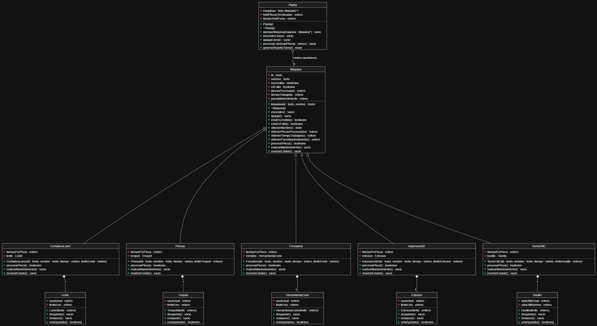

# Simulador de una Planta de Manufactura Automatizada

Proyecto del Parcial 2 de Programación Orientada a Objetos.

La guía completa del proyecto está en [PROYECTO.md](PROYECTO.md). Léanla antes de empezar.

## 1. Equipo

| Bloque | Matrícula | Nombre | Usuario de GitHub | Máquina | Componente |
| --- | --- | --- | --- | --- | --- |
| 1 | 25317 | Yair Alberto Flores Peña | yairflores09 | cortadora laser | lente |
| 2 | 22038 | Jesús René Pamanes Ferreira | TacocraftG | Impresora 3D | Extrusor |
| 3 | 25029| Daniel Alejandro Hernandez Sanchez | danielhernandez | prensa | Tronquel |
| 4 | 25132 | Arturo Lugo Rodriguez |ArturoLugoRodriguez |Fresa|Heramienta de corte|
| 5 | 25238 | Daniel Guerra  | mowhackcat| Torno CNC| Husillo|

## 2. Orden de la línea

Escriban el orden en que una pieza recorre las estaciones.

[TornoCNC--> Cortadora Laser--> Fresadora --> Prensa --> Impresora 3D]

## 3. Cómo compilar y ejecutar

Escriban el comando exacto que usa el equipo para compilar y el comando para ejecutar.

// Compilar:
 g++ -Wall -Wextra -std=c++17 -Iinclude src/*.cpp -o planta
// Ejecutar:
 ./planta

## 4. Reglas de la simulación

**¿En qué momento exacto falla una máquina?**

cuando su componente que llega a sufrir de desgasta falla. ejemplo: Extrusor Fallo.

**¿El mantenimiento suma tiempo al turno? ¿Cuánto?**

En nuestro caso no suma tiempo.

## 5. Cálculo a mano del reporte

Lote de 20 piezas. Una fila por máquina.

| Máquina | Segundos por pieza | Límite del componente | Fallas en 20 piezas | Tiempo trabajado |
| --- | ---: | ---: | ---: | ---: |
| Torno CNC | 30 | 8 | 2 | 600 |
|  |  |  |  |  |
|  |  |  |  |  |
|  |  |  |  |  |
| Impresora3D | 120 | 15 | 1 | 2400 |

**Reporte esperado (piezas terminadas, tiempo total y paros):**
TornoCnC1..........20piezas 600segundos 2paros.
X
Y
Z
Bambu Labs5..........20piezas 2400segundos 1paros.

**¿Coincide con lo que imprime el programa? Si no coincidió al primer intento, ¿qué encontraron?**
TornoCNC si coincide
Impresora 3D si coincide
## 6. Diagrama general

Diagrama de clases de la solución completa, hecho en draw.io. Guarden la imagen como `docs/diagrama_general.png`.

## 7. Documentación individual

| Integrante | Documentación de su clase | Propuesta de mejora |
| --- | --- | --- |
| Daniel Alejandro Hernandez Sanchez | Pendiente de agregar (`docs/Prensa.md`) | Pendiente de agregar (`docs/mejoras/25029/mejora.md`) |
| Jesús René Pamanes Ferreira | [Impresora3D.md](docs/mejoras/22038/Impresora3D.md) | [mejora.md](docs/mejoras/22038/mejora.md) |
| | | |
| | | |
| | | |

## 8. Cambios a `Maquina.h`

Si el equipo modificó la interfaz de la clase base, expliquen qué cambió y por qué. Si no hubo cambios, escriban "Sin cambios".

no se realizo ninguno cambio a la clase maquina.
