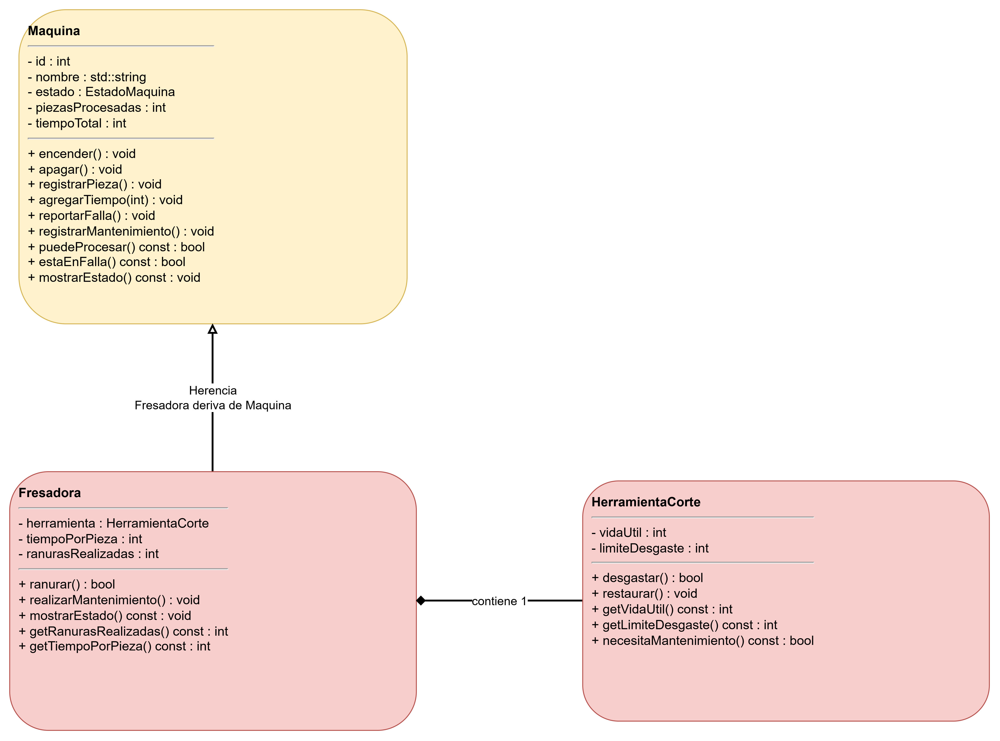

# Documentación de la clase: [Inserta aquí el nombre de tu clase]

> Copia este archivo como `docs/<Clase>.md` (por ejemplo, con el nombre de tu máquina) y llena tu copia. No modifiques la plantilla.

**Elaborada por:** [Arturo Lugo Rdodriguez]
**Matrícula:** [25162]
**Bloque:** [2]

## 1. Propósito

**¿Qué máquina representa tu clase y qué operación hace sobre la pieza?**

[Fresadora maquina que realiza un ranurado en la pieza mediante herramienta de corte ]

**¿Cuál es su componente y por qué no existe sin la máquina?**

[su componente es Heraniebta de corte, por que no hay quien la utilize de la misma manera ]

## 2. Decisiones de diseño

**Atributos propios de tu clase y validación de cada uno:**

[tiempoPorPieza: almacena el tiempo que tarda en procesarse una pieza. Se valida que sea mayor que cero.
ranurasRealizadas: registra la cantidad de ranuras realizadas. Comienza en cero y aumenta cada vez que se procesa una pieza.
herramienta: objeto de la clase HerramientaCorte que controla el desgaste del componente.]

**Métodos propios (los que la clase base no tiene):**

[ranurar(): realiza la operación de ranurado si la máquina puede procesar y la herramienta no ha alcanzado su límite de desgaste.
realizarMantenimiento(): restaura la herramienta cuando la máquina presenta una falla.
getRanurasRealizadas(): devuelve la cantidad de ranuras realizadas.
getTiempoPorPieza(): devuelve el tiempo configurado por pieza.]

**Método de la base que redefines, y cómo reutilizas la versión de la base:**

[mostrarEstado() de la clase base Maquina. Dentro de la redefinición se llama a Maquina::mostrarEstado() para reutilizar la información general de la máquina. Después se agregan los datos específicos de la fresadora, como las ranuras realizadas, el tiempo por pieza y el desgaste de la herramienta.]
**¿Cómo modelaste el desgaste del componente y por qué así?**

[mediante el atributo vidaUtil, que aumenta en uno cada vez que la herramienta procesa una pieza. El atributo limiteDesgaste establece la cantidad máxima de usos permitidos. Cuando la vida útil alcanza ese límite, la herramienta necesita mantenimiento y la fresadora registra una falla. Durante el mantenimiento, el desgaste se reinicia a cero. Este modelo permite simular de forma sencilla el desgaste de una herramienta.]

**¿Qué usa tu clase de `Maquina` y qué agrega?**

[La clase Fresadora hereda de Maquina las funciones generales para comprobar si puede procesar, registrar piezas, acumular tiempo, reportar fallas y registrar mantenimiento. Además, agrega la operación de ranurado, el tiempo por pieza, el contador de ranuras y la composición con HerramientaCorte. También redefine mostrarEstado() para presentar información específica de la fresadora.]

## 3. Diagrama

Diagrama de tu clase y su componente, hecho en draw.io. Debe mostrar la relación de herencia con `Maquina` y la de composición con tu componente. Guarda la imagen en `docs/` y enlázala aquí.

## 4. Bitácora

**Dudas que tuviste y cómo las resolviste:**

[ La clase Fresadora hereda de Maquina las funciones generales para comprobar si puede procesar, registrar piezas, acumular tiempo, reportar fallas y registrar mantenimiento. Además, agrega la operación de ranurado, el tiempo por pieza, la composición con HerramientaCorte. También redefine mostrarEstado() .]

**Errores que encontraste y cómo los corregiste:**

[Se consideraron posibles errores como establecer un tiempo por pieza igual o menor que cero, definir un límite de desgaste inválido o intentar ranurar cuando la máquina está apagada o presenta una falla. Para evitarlos, se agregaron validaciones en el constructor y comprobaciones antes de realizar la operación. También se implementó el mantenimiento para restaurar el desgaste de la herramienta cuando se registra una falla.]
