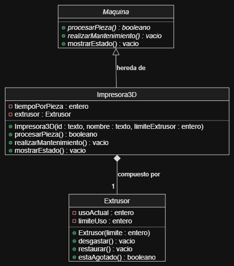

# Documentación de la clase: Impresora3D

> Copia este archivo como `docs/<Clase>.md` (por ejemplo, con el nombre de tu máquina) y llena tu copia. No modifiques la plantilla.

**Elaborada por:** Jesús René Pamanes Ferreira
**Matrícula:** 22038
**Bloque:** 2

## 1. Propósito

**¿Qué máquina representa tu clase y qué operación hace sobre la pieza?**

La clase representa una impresora 3D que aplica un inserto de filamento en el producto que se manufactura. 

**¿Cuál es su componente y por qué no existe sin la máquina?**

El extrusor, ya que es un atributo de la clase Impresora3D.

## 2. Decisiones de diseño

**Atributos propios de tu clase y validación de cada uno:**

La clase tiene dos atributos:

- `tiempoPorPieza`: es el tiempo de que tarda el proceso por pieza que se decidio como un total de 120 segundos, se inicializa dentro de Impresora3D.h y no se solicita al crear clases impresora.

- `extrusor`: lleva la cuenta de piezas procesadas y el limite maximo de piezas que se pueden procesar antes de registrar un fallo.

**Métodos propios (los que la clase base no tiene):**

- `procesarPieza()`: Sirve para comprobar que la impresora pueda trabajar, registra una pieza, sumar 120 segundos y desgastar el extrusor (aumentar el contador de uso), cuando esto ultimo llega al limite establecido (15 turnos) , se reporta la falla y se llama al metodo mantenimiento.

- `realizarMantenimiento()`: si la impresora está en falla, restaura el contador del extrusor y registra un paro.

- `mostrarEstado()`: presenta el estado general de `Maquina`, el tiempo por pieza y el uso actual y límite del extrusor.

**Método de la base que redefines, y cómo reutilizas la versión de la base:**

`mostrarEstado()` tiene la misma firma que el método de `Maquina` y llama explícitamente a `Maquina::mostrarEstado()` para incluir los datos generales antes de mostrar los propios. En la interfaz actual de `Maquina`, este método no está declarado `virtual`; por eso, la llamada a través de un apuntador de tipo `Maquina*` no selecciona automáticamente la versión de `Impresora3D`.

**¿Cómo modelaste el desgaste del componente y por qué así?**

Por medio de un contador, cuando se llega al limite de este contador se considera que el elemento esta muy desgastado o averiado y se necesita realizar un mantenimiento. Se hizo de esa forma para hacer más abstracto el ejemplo de la linea de produccion.

**¿Qué usa tu clase de `Maquina` y qué agrega?**

La impresora reutiliza de `Maquina` el identificador, el nombre, el estado encendido/en falla y los contadores de piezas, tiempo trabajado y paros. Usa `puedeProcesar()` antes de trabajar, `registrarPieza()` y `agregarTiempo()` durante el proceso, `reportarFalla()` al agotarse el extrusor y `registrarMantenimiento()` al repararlo. Agrega la duración fija, el extrusor y las operaciones específicas de impresión y mantenimiento.

## 3. Diagrama

## 4. Bitácora

**Dudas que tuviste y cómo las resolviste:**

**Errores que encontraste y cómo los corregiste:**

No se llama al metodo mantenimiento cuando el extrusor se agotaba, por lo que se quedaba varada la produccion, se corrigio llamando al metodo realizarMantenimiento() al detectar la falla, para restaurar el extrusor, registrar un paro y permitir que la impresora vuelva a procesar piezas.