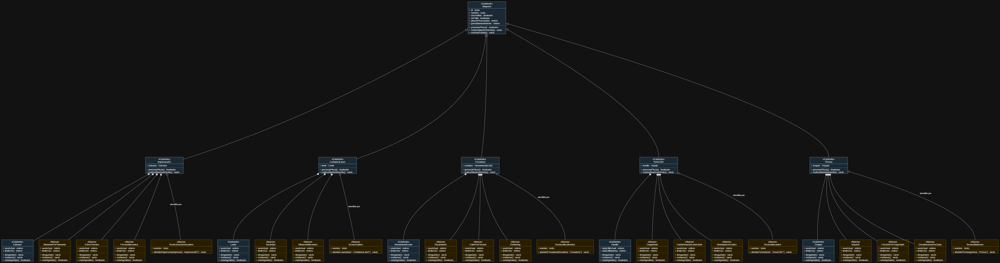

# Propuesta de mejora: Modelado realista del desgaste y mantenimiento de las máquinas

> Crea una carpeta dentro de `docs/mejoras/` con tu número de matrícula como nombre, copia este archivo ahí como `mejora.md` y llena tu copia. No modifiques la plantilla.
>
> La propuesta es solo diseño: no se programa.

**Propuesta de mejora elaborada por:** [Jesus Rene Pamanes Ferreira]

## 1. Impacto

**¿Es una mejora o una corrección?**

Una Mejora

**¿Qué observaste en la solución del equipo que dio origen a la propuesta?**

La forma en la que se desgasta un objeto y se determina que este necesita mantenimiento es algo no muy realista.

**¿Qué mejora o qué corrige, y por qué vale la pena?**

La actualizacion consiste en crear clases nuevas para los factores de desgaste de los componentes y el mantenimiento de las maquinas. Vale la pena ya que sería más fiel a una simulación de una linea de producción.

## 2. Qué implica

Esto implica le declaracion e implementacion de clases nuevas.

Clases para que interactuan con Impresora 3D: `abrasionPorFilamento.h, estresTermico.h, friccionMecanica.h, tecnicoElectromecanico.h`

Clases para que interactuan con Cortadora Laser: `suciedad.h, vibracionMecanica.h, Tecnico_Optico.h`

Clases para que interactuan con Fresadora: `rozamiento.h, calorPorFriccion.h, chattering.h, tecnicoMecatronico.h`

Clases para que interactuan con TornoCNC: `cargaAxial.h, contaminacionLubricante.h, desbalanceoCiclico.h, tecnicoMecanico`

Clases para que interactuan con Prensa: `impacto.h, friccionPorTroquelado.h, desalineacionDeGuias.h, tecnicoMatricero.h`

**Comportamiento nuevo en clases existentes:**

`Le pedi a una IA que generara este texto con mi idea.`:

Cada máquina acumularía desgaste en sus factores correspondientes durante el procesamiento de una pieza, además del desgaste que ya registra su componente. Al alcanzar el límite de cualquiera de esos factores, la máquina reportaría una falla y no procesaría más piezas hasta recibir mantenimiento. El técnico especializado atendería la máquina, restauraría el factor y el componente afectados, y la máquina registraría el mantenimiento como un paro. El flujo conservaría el registro actual de piezas, tiempo trabajado y paros.

**Interacciones nuevas entre objetos:**

`Le pedi a una IA que generara este texto con mi idea`:

Al procesar una pieza, cada máquina solicitaría a sus objetos de desgaste que actualicen su nivel de uso: la Impresora 3D consultaría la abrasión por filamento, el estrés térmico y la fricción mecánica; la Cortadora Láser, la suciedad y la vibración mecánica; la Fresadora, el rozamiento, el calor por fricción y el *chattering*; el Torno CNC, la carga axial, la contaminación del lubricante y el desbalanceo cíclico; y la Prensa, el impacto, la fricción por troquelado y la desalineación de guías. Si alguno requiere mantenimiento, la máquina reportaría la falla y pediría la intervención de su técnico especializado. El técnico repararía o restablecería los elementos afectados antes de que la máquina reanude el procesamiento.

**Relaciones nuevas (herencia, composición o agregación) y por qué son de ese tipo:**

Composicion:
Cada una de las maquinas va tener una relacion de composicion con las clases de desgaste, esto porque no tendria sentido modelar este desgaste sin que existiera una maquina, es decir, sin la existencia de una maquina, no existira el desgate.

Agregacion:
El técnico existe independientemente de una máquina y puede atenderla cuando sea necesario. No se propone cambiar la herencia actual de las máquinas respecto a `Maquina`.

## 3. Diagrama de clases

Diagrama hecho en draw.io que muestre la solución con la mejora incorporada. Distingue lo nuevo de lo existente, por ejemplo con otro color. Guarda la imagen en esta misma carpeta y enlázala aquí.

El diagrama distingue las clases existentes en azul de las clases nuevas propuestas en amarillo. Los factores de desgaste se componen en cada máquina y los técnicos se agregan para realizar el mantenimiento.

