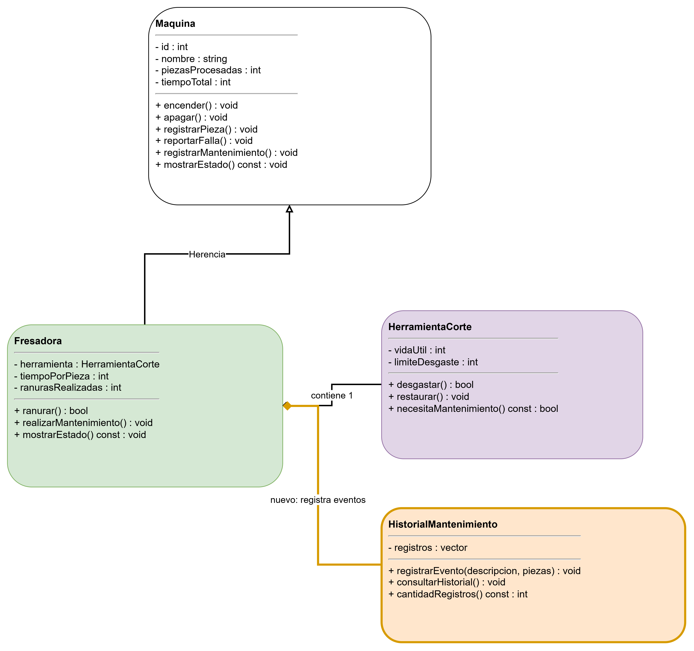

# Propuesta de mejora: [Inserta aquí el título de tu propuesta]

> Crea una carpeta dentro de `docs/mejoras/` con tu número de matrícula como nombre, copia este archivo ahí como `mejora.md` y llena tu copia. No modifiques la plantilla.
>
> La propuesta es solo diseño: no se programa.

**Propuesta de mejora elaborada por:** [Inserta aquí tu nombre]

## 1. Impacto

**¿Es una mejora o una corrección?**

[Hacer algo con menos pasos o de manera mas eficiente ]

**¿Qué observaste en la solución del equipo que dio origen a la propuesta?**

[Observé que la fresadora puede detectar fallas relacionadas con el desgaste de la herramienta de corte y realizar mantenimiento para restaurarla]

**¿Qué mejora o qué corrige, y por qué vale la pena?**

[agregar un sistema de historial de mantenimiento para registrar las fallas y las intervenciones realizadas en la fresadora.]

## 2. Qué implica

**Clases nuevas:**

[Se propone crear una clase llamada HistorialMantenimiento, encargada de almacenar y consultar los registros de mantenimiento de la fresadora.]

**Comportamiento nuevo en clases existentes:**

[La clase Fresadora incorporarí tendria la capacidad de registrar un evento en HistorialMantenimiento cuando detecte una falla por desgaste de la herramienta de corte]

**Interacciones nuevas entre objetos:**

[Cuando la fresadora detecte una falla, enviaría la información correspondiente al objeto HistorialMantenimiento. Cuando se realice el mantenimiento, la fresadora registraría la intervención y el estado de la herramienta.]

**Relaciones nuevas (herencia, composición o agregación) y por qué son de ese tipo:**

[Se propone una relación de composición entre Fresadora y HistorialMantenimiento, porque el historial se considera parte del funcionamiento de la fresadora dentro de este diseño. La fresadora tendría un objeto HistorialMantenimiento encargado de administrar sus registros.]

## 3. Diagrama de clases

Diagrama hecho en draw.io que muestre la solución con la mejora incorporada. Distingue lo nuevo de lo existente, por ejemplo con otro color. Guarda la imagen en esta misma carpeta y enlázala aquí.

