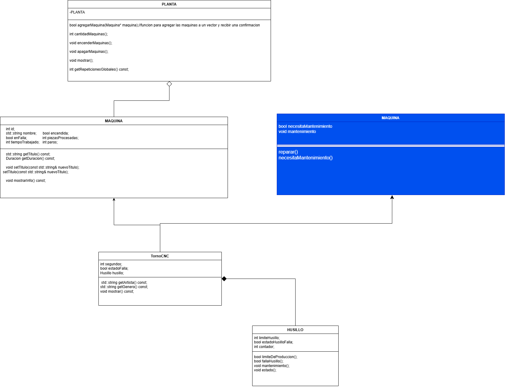

# Propuesta de mejora: clase mantenimiento

> Crea una carpeta dentro de `docs/mejoras/` con tu número de matrícula como nombre, copia este archivo ahí como `mejora.md` y llena tu copia. No modifiques la plantilla.
>
> La propuesta es solo diseño: no se programa.

**Propuesta de mejora elaborada por:** Daniel Guerra

## 1. Impacto

**¿Es una mejora o una corrección?**

mejora pero al mismo tiempo una correcion

**¿Qué observaste en la solución del equipo que dio origen a la propuesta?**

ademas de las maquinas establecidas, se necesita algo para transportar las piezas, en vez de ser una de las 5 maquinas, esta se tenga que usar por defecto

**¿Qué mejora o qué corrige, y por qué vale la pena?**

implica un mejor orden y mejora la logica de produccion

## 2. Qué implica

**Clases nuevas:**

Mantenimiento

**Comportamiento nuevo en clases existentes:**

reparar(), necesitaMantenimiento()

**Interacciones nuevas entre objetos:**

los objetos podrian heredar las funciones para realizar mantenimiento en vez de declararlo individualmente

**Relaciones nuevas (herencia, composición o agregación) y por qué son de ese tipo:**

herencia, para que reciba las funciones y pueda utilizarlas la misma maquina

## 3. Diagrama de clases

Diagrama hecho en draw.io que muestre la solución con la mejora incorporada. Distingue lo nuevo de lo existente, por ejemplo con otro color. Guarda la imagen en esta misma carpeta y enlázala aquí.

