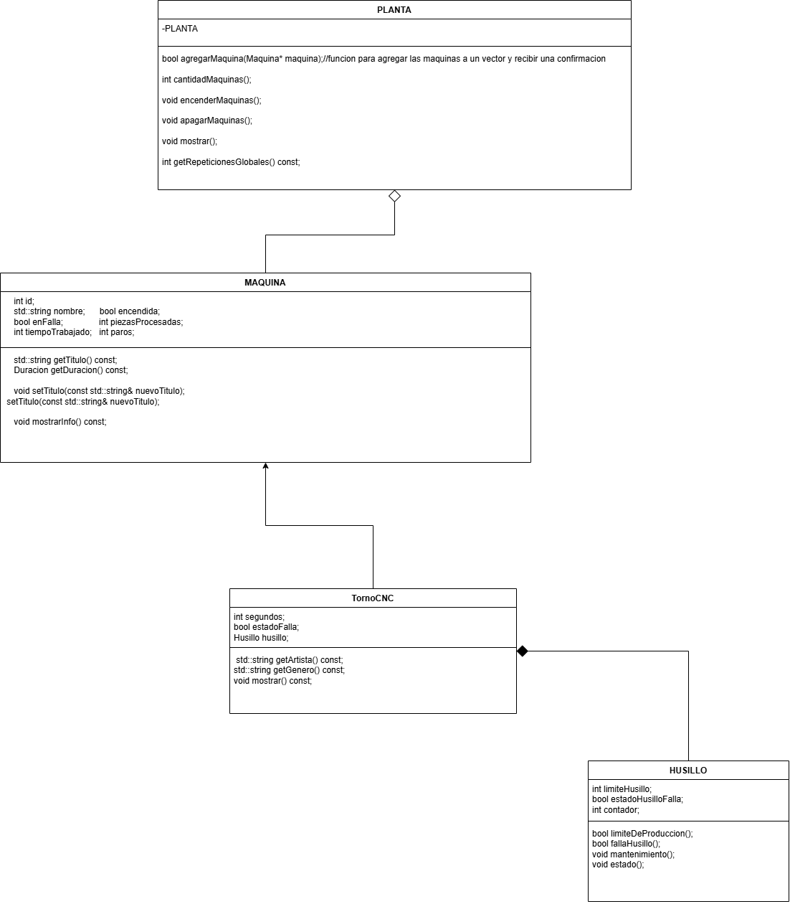

# Documentación de la clase: [Inserta aquí el nombre de tu clase]

> Copia este archivo como `docs/<Clase>.md` (por ejemplo, con el nombre de tu máquina) y llena tu copia. No modifiques la plantilla.

**Elaborada por:** Daniel Gerardo Guerra Rodriguez
**Matrícula:** 25238
**Bloque:** idk

## 1. Propósito

**¿Qué máquina representa tu clase y qué operación hace sobre la pieza?**

es una maquina de torno de control numerico, procesa la pieza, lleva un contador de dichas piezas realizadas y el tiempo acumulado y controla las fallas del elemento que se desgasta

**¿Cuál es su componente y por qué no existe sin la máquina?**

Husillo, sin ella no podria hacer el trabajo

## 2. Decisiones de diseño

**Atributos propios de tu clase y validación de cada uno:**

int segundos;
bool estadoFalla;
Husillo husillo;

**Métodos propios (los que la clase base no tiene):**

void mantenimiento();
void procesarPieza();
void reportarFallaTorno();

**Método de la base que redefines, y cómo reutilizas la versión de la base:**

void registrarPiezaTorno();
 llama a la funcion base Maquina::registrarPieza();
void agregarTiempoTorno(int segundos);
 llama a la funcion base Maquina::agregarTiempo(segundos);
int getSegundos() const;
 llama de la funcion base a getsegundos()

**¿Cómo modelaste el desgaste del componente y por qué así?**

utilizando un contador, que aumentara hasta llegar a cierta condicion que marcara el error

**¿Qué usa tu clase de `Maquina` y qué agrega?**

Utiliza las funciones apagar(); registrarMantenimiento(); aquina::agregarTiempo(segundos)

## 3. Diagrama

Diagrama de tu clase y su componente, hecho en draw.io. Debe mostrar la relación de herencia con `Maquina` y la de composición con tu componente. Guarda la imagen en `docs/` y enlázala aquí.

## 4. Bitácora

**Dudas que tuviste y cómo las resolviste:**

como colocar el diagrama en uno de los docs de texto, pregunarle al maestro

**Errores que encontraste y cómo los corregiste:**

pasar por mi refencia a la lcase en una funcion provocaba que realizara el ciclo un gran numero de veces, elimine esa parte y modifique la funcion
